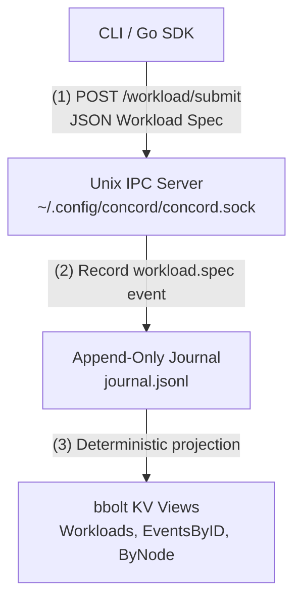
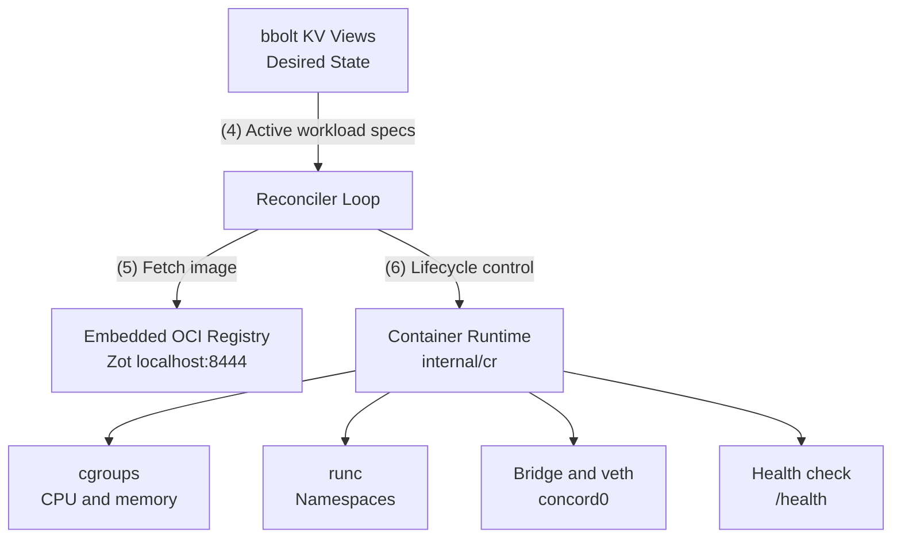
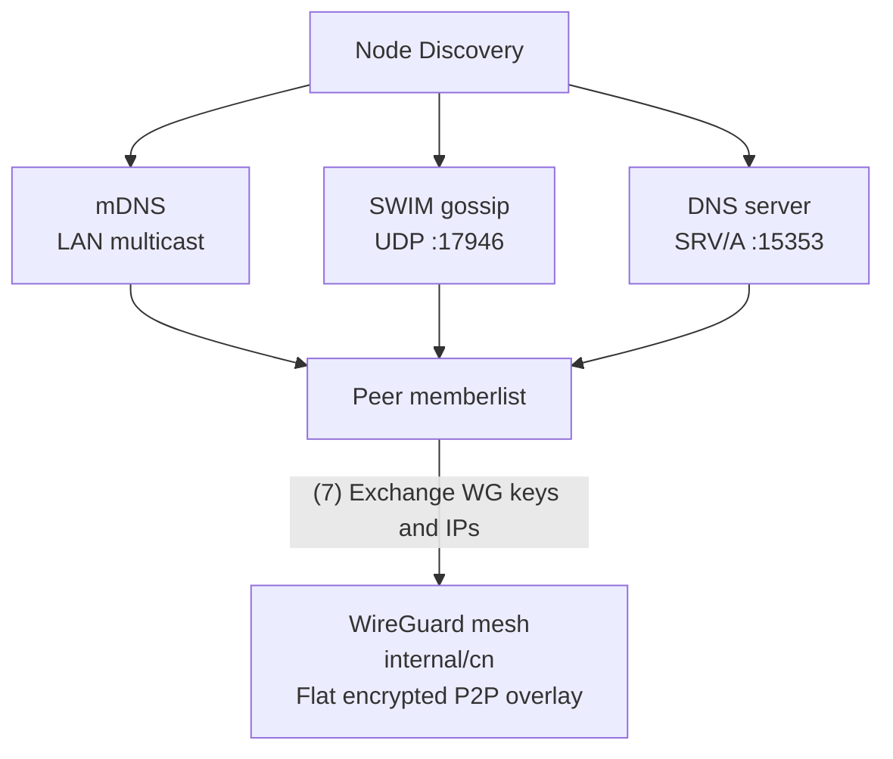
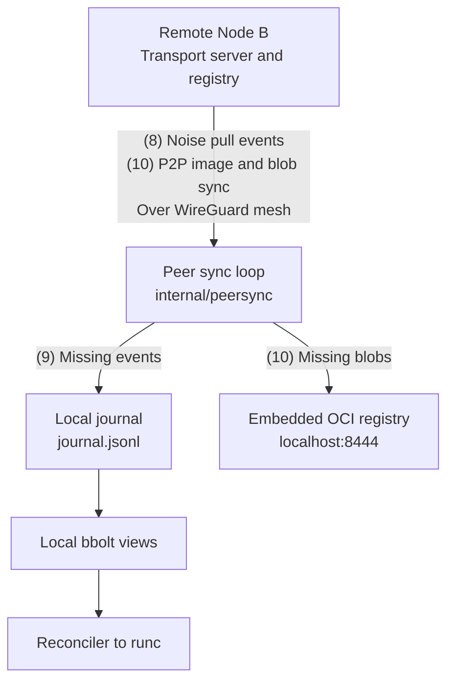

# Architecture & Data Flow

Concord is a decentralized coordination engine. State is driven by an append-only event log, projected into local views, reconciled against container runtimes, and synchronized across nodes over an encrypted mesh.

---

## Data Flow Diagrams

### 1. Workload Submission Flow

### 2. Local Workload Reconciliation & Execution Flow

### 3. Peer Discovery & WireGuard Mesh Flow

### 4. Cross-Node State & Image Replication Flow

---

## Underlay vs overlay

Concord uses two disjoint IPv4 spaces.

**Underlay** is the host NIC. Memberlist, mDNS, and the Noise
transport use it. Join targets are underlay addresses. Peers
dial whatever `ResolveAdvertise` published, never `cn0`.

**Overlay** is `10.0.0.0/16`. Each node has `cn0` at
`10.0.{index}.1/24` and allocates containers in that `/24`.
WireGuard carries peer `/24`s between nodes. Memberlist
must not advertise `cn0`, `wg-*`, or any `10.0.0.0/16`
address. Joining an overlay IP on a node that also has
`cn0` is a local TCP connect, not a peer.

Resonance simulator attaches a tun as the
underlay NIC. That tun must not use `10.0.0.0/16`. Use a
disjoint prefix such as `192.168.100.0/24`, one address per
node. Overlay stays `10.0.0.0/16` inside each netns. If the
tun is `10.0.0.1` / `10.0.0.2`, Concord cannot tell underlay
from `cn0`, Join hits the local bridge, and membership
stays at one node.

---

## Scheduling

In each connected segment, the node with the lowest UUID string is the leader. It assigns unassigned workloads to the peer with the fewest active workloads. When segments reunite, journals sync and state converges.

---

## Conflict model

Concord sidesteps most conflicts by construction: every `workload run` mints a fresh unique ID, so concurrent submissions never disagree about the same key. Merge of distinct IDs is a union.

That union is a CvRDT (convergent replicated data type): the journal is a grow-only set of immutable events, merge is set union, and union is associative, commutative, and idempotent. Sync applies unknown IDs and skips known ones, so every segment converges to the same event set regardless of partition history or arrival order. Views are deterministic projections of that set: tombstone dominance, byte-larger live specs, and highest-generation pins all resolve without clocks.

The sidestep leaks in one place. Nodes re-record the spec (scheduler claiming writes its own `workload.spec` copy per ID), so one workload ID can end up with several distinct spec events from different authors. These are conflicting same-ID writes, and the view must resolve them deterministically.

Landed rules in `internal/journalview/workloads.go` (`putEvent`):

* Tombstone dominance. A stored tombstone (`Removed=true`) is never replaced by a live spec copy, regardless of arrival order. A stop wins over any spec copy.
* Live-live tiebreak. Two live specs for one ID resolve by deterministic comparison: the byte-larger serialization wins, regardless of arrival order.

Both rules are order-independent: every node converges to the same stored copy no matter the sync arrival sequence. No wall-clock or logical timestamp participates in these paths.
